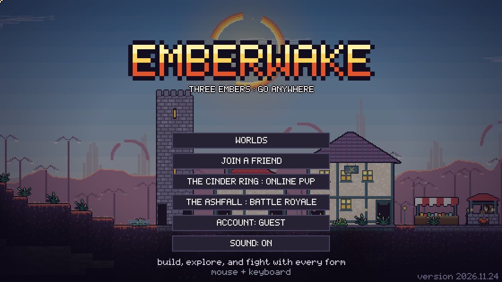

# Start here

Emberwake is a 2D pixel-art open-world game in the spirit of Terraria. Dig, build, craft and fight across an endless world and seven other worlds beneath and above it, alone or with up to three friends. Fighting is about timing, not mashing. There are two arenas too: quick duels in the Cinder Ring, and the Ashfall Trials, a survival match for twelve. No internet is needed to play alone.

## What's in the folder

| In the folder | What it is |
| --- | --- |
| **Emberwake.app** | the game as a Mac app: double-click it to play |
| **Emberwake.html** | the same game for any computer: double-click it to play in your web browser |
| **Emberwake Guide.html** | this guide |
| **Source** | everything for changing the game: its code, this guide's text, the Mac app's parts, and the tests |

The app and the HTML file each work on their own, so you can move either one anywhere (the app into Applications, the HTML file onto a USB stick).

## On a Mac

Drag **Emberwake.app** into your Applications folder and double-click it. The game opens in its own window with its own icon and menu, using the web engine built into macOS, so you don't need a browser.

The first time, macOS warns that it can't check the app, because it isn't from the App Store or a registered developer. To open it anyway:

- **macOS 15 Sequoia and later:** double-click the app and click **Done**. Then open **System Settings > Privacy & Security**, scroll down, and click **Open Anyway** next to Emberwake.
- **Earlier macOS:** right-click (or Control-click) the app, choose **Open**, then click **Open** again.
- **Or, in Terminal:** `xattr -cr /Applications/Emberwake.app`

After that it opens with a normal double-click. **Cmd+Q** quits, **Ctrl+Cmd+F** switches full screen on and off, and closing the window quits too.

## On any other computer

Double-click **Emberwake.html** to play in your web browser (Chrome, Safari, Edge or Firefox), on Windows, Linux, a Chromebook or a Mac.

It plays in the browser of a phone or a tablet too. Touch controls appear by themselves (see *Controls: On a phone or tablet*).

## Signing in

The game opens on the **ACCOUNTS** board. The first time, choose **+ CREATE ACCOUNT**: type a name and a password (eight characters or more, typed twice), pick a look and a **hat**, and you are in. After that, **SELECT** your account, type its password and choose **LOG IN**.

- **An account lives in this browser** (or in the app). Nothing is sent anywhere, so there is nobody to ask if you forget the password.
- **Your worlds are yours.** Each account has its own list of worlds. Worlds made before there were accounts go to the first account made.
- Above the **WORLDS** board you see your account's name and **SIGN OUT**. Click the name to come back to the ACCOUNTS board, where **CHANGE LOOK** lets you choose another look or hat, and **+ CREATE ACCOUNT** makes one for somebody else who plays here.

## Your saves

Saves stay on the computer you play on, with the account that made them. The app and each browser keep their own accounts and their own saves.

To take a world from the app to a browser, or to another computer, choose **COPY** next to the world in your world list. On the other side, choose **PASTE A WORLD**.

> Everyone you play with needs this same version of the game. When you get a new version, send your friends the new Emberwake.html (or the app) too.
