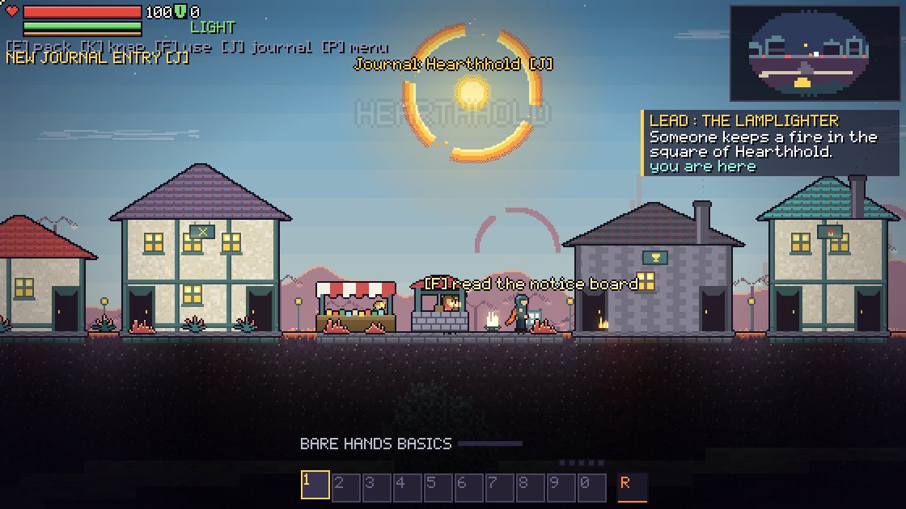
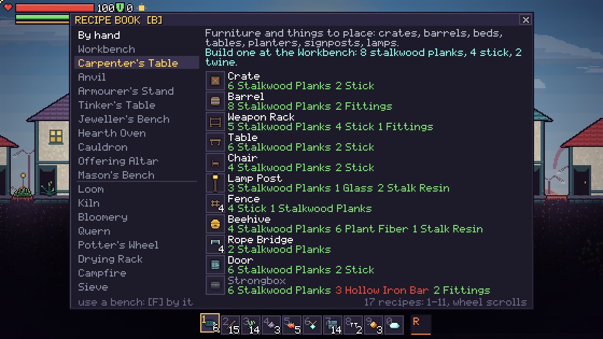
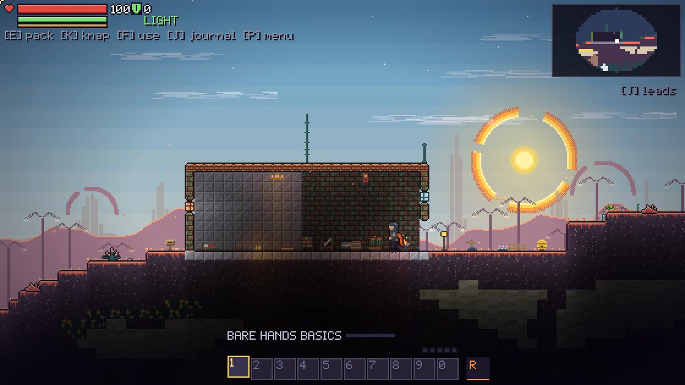
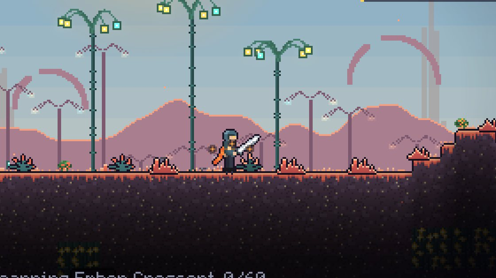
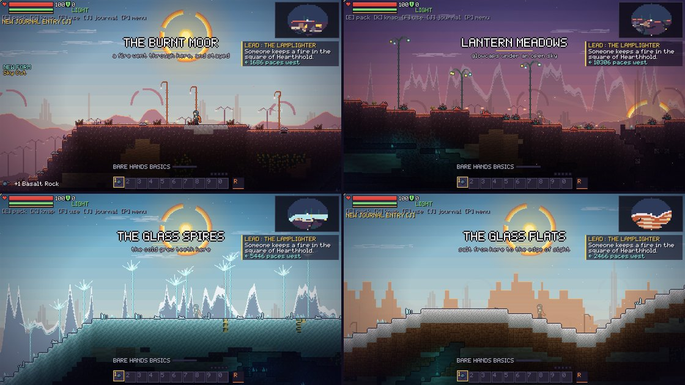
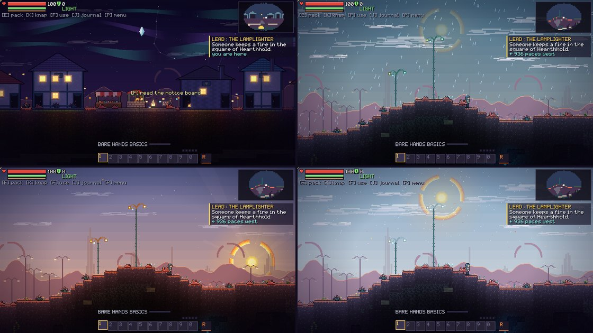
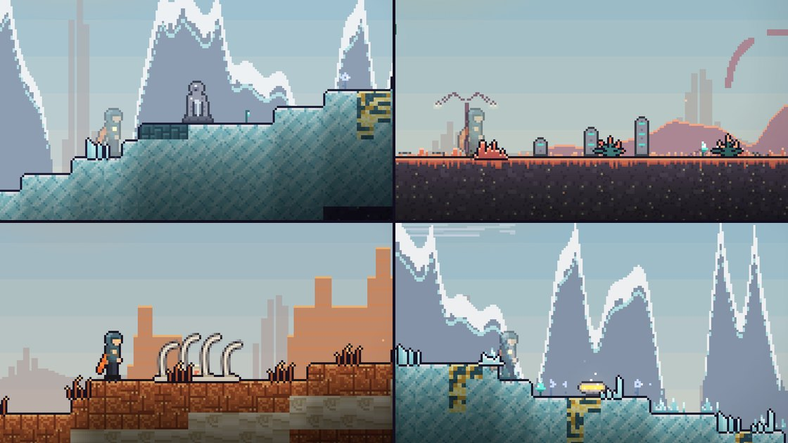

# How to play

You wake with nothing. Everything after that is up to you: there is no wrong order, and nothing forces you along.

## Crafting

Open your pack (**E**). The **BY HAND** list shows everything you can make anywhere. Green lines you can make now, and each ingredient shows what you have against what it needs (for example *2/3 Plant Fiber*). Hover a line to see it spelled out, and click to make it. The things you can almost make come first.

Everything else is made at **benches** you build and place. Each bench has one job, so you always know where to go. Stand next to one and press **F**: its list works the same way, and a bench with a long list has a **SHOW** button (weapons, tools, armour...) and a **CAN MAKE** switch. Every item's tooltip says where it is made, and the **recipe book** (**B**) lists every bench, what it is for, how to build it, and everything it makes.

At the Workbench, choose **SHOW: ARMOUR** to see every set together. Armour takes fewer materials than it did, and all of it is made there: no separate stand, and no anvil of the armour's rank.

| Bench | What it is for |
| --- | --- |
| **Workbench** | woodwork and armour: planks, doors, ladders, wooden and bone weapons, most other benches, and every piece of armour (metal and other-world sets too) |
| **Carpenter's Table** | furniture and things to place: crates, barrels, beds, tables, planters, signposts, lamps |
| **Anvil** | metal weapons and tools. Stone anvil: copper and bronze. Iron anvil: iron and steel. Slagforge: the metals of the other worlds |
| **Armourer's Stand** | an older bench, kept so that worlds which have one stay as they are. It has nothing left to make: armour is made at the Workbench |
| **Tinker's Table** | gadgets you carry (lanterns, glider, climbing claws, compass, gauges), traps and the ember ballista |
| **Jeweller's Bench** | trinkets you wear: rings, charms and amulets |
| **Hearth Oven** | hot meals that give a boon for a few minutes |
| **Cauldron** | brews: salves, tonics, antidotes, flasks to throw |
| **Offering Altar** | the offerings that wake the guardians, the lamps that call the sky, and the keys between worlds |
| **Mason's Bench** | cut stone: blocks, walls, statues, fountains, the stone anvil and the oven |

The **workshops** turn raw things into materials: the kiln (brick, glass, charcoal, pots), the bloomery (ore into bars), the loom (cloth, rugs, banners, bags), the quern (ore, powder, flour), the potter's wheel, the drying rack, the sieve and the campfire.

## Trinkets and meals

**Trinkets** work while you wear them. You start with **two trinket slots**; the first time you beat the Ashen Warden, Vesper, the Forge-Keeper and the Slag Tyrant, each opens one more (six in all). A few of the many: the Quickstep Ring (walk faster), the Miner's Charm (dig faster), the Ashen Veil (a wider window for a perfect dodge), the Counter Sigil (counters hit harder), the Rhythm Bead (follow-ups pay more), the Thorn Ring, the Fang Necklace (blows drink a little life), the Ember Heart (slow healing). Each guardian also leaves a trophy trinket of its own.

**Meals** from the Hearth Oven fill you up and give one boon for a few minutes: an Emberberry Pie makes you **QUICK**, a Hunter's Pie **HEARTY**, a Honey Cake **SWEET** (stamina), a Fire Roast **WARM**, a Glowcap Stew **GLOWING**, Spiced Jerky **FIERCE**, a Miner's Stew **DELVING**, and the Waker's Feast does several at once. The last meal you ate is the one that counts. Flour comes from reeds at the quern; honey from a beehive.

## Eating and brews

**Eating takes a moment.** Your Waker stops to lift the food, a bite is quick, and a meal or a drink takes a little longer. **A blow interrupts it**, and you keep the food. So eat before the fight or step out of it first.

**Brews** are drinks that change a fight for a short while. Each rank of brew needs a better vessel:

| Brew | Made at | What it does |
| --- | --- | --- |
| **Quickstep Brew** | a **Cauldron** | you move more than a quarter faster for 40 seconds |
| **Emberheart Brew** | a **Brewer's Stand** (built at a Workbench) | your blows hit about a fifth harder for 30 seconds |
| **Doublesoul Draught** | a **Moon Cauldron** (built at a Mason's Bench, around a cauldron) | calls a **mirror** of you for 40 seconds |

Only one of the first two burns in you at a time: drink another and it takes the place of the first. The time left shows with your boons.

**The mirror** stands up beside you with the weapon you hold. It repeats your last few steps, then fights with a mind of its own. It hits more lightly than you do and can be beaten down. You can have one mirror at a time, and it will not come again until a minute after you called it: it stays forty seconds, so that is twenty seconds after it goes home.

The brews want things from the two new lands (see *No two worlds alike*): a **willow feather** for Quickstep, **willow eggs** for Emberheart, a **moonseed** for the Doublesoul Draught. Two eggs, salt and berries at the Hearth Oven make a **Willow Omelet**, a **HEARTY** meal. The recipe book (**B**) has every recipe.

Feathers can be had in any world: besides the willow hen, the **galewisp** that walks in a thunderstorm leaves them. **Eggs and moonseed cannot.** Eggs come only from the willow hen and a moonseed only from the moss deer, and those two live only in the Mosswood and the Willowmere. These two lands are in worlds forged in this version, and in worlds brought over from the version that had accounts. An older world has neither land, so the Emberheart Brew, the Doublesoul Draught and the Willow Omelet cannot be made there: do not hunt for eggs or moonseed in it.

## Things to place

- **Storage:** crates (10 stacks), barrels (20) and strongboxes (30), as well as chests.
- **A bed:** you wake there after a fall. Sleep in it (**F**) to pass the night and wake **rested** (you heal for a while). A table, a chair and a light nearby make it **cosy**, and the rest lasts twice as long.
- **Planter boxes:** plant berries, reeds, fibre, mushrooms or glowcaps, and come back when it's ripe. Mushrooms like the dark; the rest like the sun.
- **Beehives** make honey, faster near flowers and berry bushes. **Fountains** fill your empty jugs, and heal you while you rest beside them. **Braziers** keep the cold off.
- **Defences:** spike traps and snares for whatever walks over them, the **ember ballista** that shoots creatures coming close, and a **warning bell** that rings when they do.
- **Signposts** show on your map. A **weapon rack** shows off a weapon. Lamp posts, candles and chandeliers light a room; tables, chairs, bookshelves (read them!), rugs, banners, fences, statues, flower pots, stained glass, polished stone, mosaic, roof tiles and mossy brick make it a home.
- **Gadgets you carry** work from anywhere in your pack: the depth gauge, the pocket watch (the time, and how long until dark) and the ore seeker (ore near you glints).

## Fighting: the beat

A fight has a pulse, and you win by keeping it. **Hammering the mouse button loses.** Holding it down does nothing at all.

- **The glint.** After every blow your weapon **glints** (your Waker catches the light too, and there is a soft tick). Strike again **on the glint** and the chain goes on. Right on it is **CRISP**: a little more damage and some stamina back.
- **Rushed.** Strike **before** the glint and the blow in your hand is **RUSHED**: weaker, much slower to recover from, and the chain starts over. This is what happens to anyone who mashes.
- **Tempo.** Every blow struck in time lights an **ember** (up to five; they circle your Waker and show above the hotbar). Each ember makes your blows hit harder. Embers fade if you stop landing blows, and you lose them when you are hit, when you rush, or when you swing at nothing.
- **Spending it.** A **heavy blow** (right mouse) takes every ember with it and hits far harder for each one. At five embers it is a **CRESCENDO**. Blades and fists get the most from this.
- **Biting.** A lone light blow hurts a sturdy foe but does not stop it: it keeps coming. Blows in time, heavy blows and clean blows **bite**: the foe flinches. So one click at a time is the weakest way to fight, and a timed chain is the strongest.
- **Clean hits.** Where the weapon lands matters. A blade or a chain: the outer half. A pike: the point, at full reach (too close and it is **JAMMED**). Fangs: in the back. A maul: the end of the swing. Fists: a punch that beats their wind-up. An arrow: the **HEAD**.
- **Their guard.** Bigger foes have a guard (a thin amber bar under their health once you test it). Blows that bite wear it down; when it **BREAKS** they reel for a moment and everything hurts them more. Guardians have one too.
- **Sunder.** A **heavy blow on a foe whose guard is broken** is a **SUNDER**: half again as hard, and it gives you back stamina and two embers. It works once each time the guard breaks. Break them, then finish it.
- **Their blows.** A foe shows **!** over its head before it strikes. Answer it: **dodge** (Shift) through the blow and strike back for a **riposte**, or **CLASH**: time a swing of your own so it meets theirs, and theirs is turned aside.
- **The answer.** For a second after a clash, your next blow is the **ANSWER**: it hits a quarter harder and always bites.
- **Perfect release.** Hold the heavy button to charge a blow, and let go **just as it flashes**: a **PERFECT RELEASE**, a fifth harder. Hold on too long and it is only a charged blow.
- **Caught.** Being hit while you wind up, or after you rush, hurts a quarter more and takes all your embers.
- **Stamina.** A rushed blow and a swing at nothing both cost stamina, so mashing leaves you with no wind to dodge or strike heavy.
- **Warded foes.** Now and then a foe carries a **shield** (you can see it, and its name says *Warded*). Plain blows from the front **glance off**. A heavy blow, a clean one or a critical one gets through, and so does anything **from behind**: dodge through it and turn. Break its guard and the shield drops while it reels.

**Each kind of weapon keeps the beat its own way.** The forms page (**C**) says how, under *In time*:

| Weapon | In time |
|---|---|
| Blades | heavy blows spend embers best |
| Pikes | a clean point lights two embers |
| Fangs | embers fade slowly |
| Mauls | a heavy blow that lands keeps two embers |
| Bows | a head shot lights two embers |
| Chains | the glint lasts longer |
| Fists | a wider moment to clash |

**How hard things hit.** Each metal is about a fifth better than the one before it, all the way up. For the same metal, a slow weapon hits hardest and a long one least, but used well they all end up within reach of each other: pick the one whose rhythm you like. **Tools are not weapons**: a tapped pick or axe does about half what a sword of the same metal does, and a wound-up swing (hold the right button) nearly as much as one.

The practice post in the village teaches all of this: press **F** at it with a weapon in hand. The journal (**J**) keeps a page called *The Beat of a Fight*. On **EASY** the timing is generous; **NORMAL** and **HARD** tighten it.

### Keeping your run

A blow or a dodge no longer stops you dead. **Hold a direction** through a swing and you keep most of your run, so you can strike on the way past and carry on. A dodge flows back into a run the same way. Take your hands off the keys and you glide to a stop. Strike behind you while you back away and you do not turn round. A blow thrown standing still is exactly as it was.

### Styles, set-ups and arts

Each kind of weapon (blades, pikes, fangs, mauls, bows, chains, fists) has its own **fighting style**, and you **learn it by using it**. A new weapon family starts at **BASICS** (the plain combo, the heavy blow, the air combo and the counter). Keep fighting with it and it grows to **FOOTWORK** (sweeps, rising strikes, dives), then **FLOW** and **MASTERY** (dashes, charged and aimed heavies). The forms page (**C**) shows what each step teaches.

**Every attack sets up the next.** A sweep knocks a foe **DOWN**: hit a downed foe with a heavy blow or from above and it **CRUSHES**. Launch a foe and your air blows **JUGGLE** it, then a dive **SPIKES** it. Lunges and dashes leave a foe **OPEN** for a heavy blow that **BREAKS** it. Thrusts **SKEWER** a pinned, hooked or reeled foe. Each family leans on some of these more than others.

**A perfect dodge** (dodge just as a blow lands) opens a **counter**: attack straight away for a riposte, aim up for a rising counter, hold **S** for a sweeping one, or use the heavy button for a reversal; in the air, a diving one.

**Arts.** The better weapons (steel and up, and the old named weapons) each hide an **art**: a big, special move. Keep landing blows with one and it teaches you; then **hold the right mouse button** to call it.

## The road ahead

The road looks roughly like this:

1. **The Waking Lands.** Gather by hand, knap flint, build a bench, a kiln, a bloomery and an anvil. Work your way through copper and bronze. Three guardians each keep one of the fallen embers: the Ashen Warden, Vesper at the Mirror Court, and the Forge-Keeper in the Drowned Forge. The world is endless in both directions and forms around you as you travel. Each guardian wakes for an **offering** (see *The guardians* below).
2. **The Furnace Gate.** With all three embers the gate opens onto the Kiln Heart, a rift into **Cinderdeep**.
3. **Cinderdeep.** A molten world under everything. Mine cinderite (it needs an embersteel pick). Build a **Slagforge** at an iron anvil (slagrock, charglass, embersteel, cinderite): it works every new tier. Wake **the Slag Tyrant** at the altar in its caldera with a Cinder Offering. Charge it into the caldera wall and it staggers.
4. **The Ember Moon.** After you have been to Cinderdeep, some nights the moon rises red and moonwretches drip **moon wax**. Make a **Moon Lantern** from it at the Offering Altar and call the moon yourself: then, late in the night, the **Pale Shepherd** walks. Its bell lets you call the Ember Moon whenever you like.
5. **The Rootward Key** (Offering Altar: Tyrant's Core, 5 cinderite bars, 3 moon wax). Touch it to any rift to open **the Rootdark**: dark, wet, lit by fungus. Gloom ore needs a cinderite pick; gloomsteel needs spore dust. **The Rootmother** wakes for a Root Offering and is rooted in place: strike her tendrils, or wait for her to bloom.
6. **Starfall and the Eclipse.** After the Rootdark, some nights shed **starshards** you can catch where they land. After the Rootmother falls, some days go dark at noon and **Umbral Knights** walk (their shields face you: strike after they swing).
7. **The Prism Key** (Offering Altar: Heartseed, 5 gloomsteel bars, 4 starshards, 2 umbral shards) opens **the Glass Expanse**: islands of a broken sky over nothing. Glass walkways join the islands and updrafts lift you to the high ones. Fall into the void and it throws you back, hurt. **The Prism Matriarch** wakes for a Prism Offering and keeps her spire: step out of the red line before it turns white.
8. Her heart makes the **Starsplitter**, or can be drunk for good.

Each of the four new guardians (the Tyrant, the Rootmother, the Matriarch and the Shepherd) makes you permanently tougher the first time you beat it. Each world has its own weather too: eruptions in Cinderdeep, spore blooms in the Rootdark, shatterstorms in the Expanse. The Waking Lands get Ashfall and the Long Fog, each with creatures that only walk then.

**Waygates.** Once you have cinderite you can forge a Waygate at a Slagforge and place it anywhere, so you don't have to walk back to the Furnace Gate.

## The guardians

The guardians answer offerings, not chance. Build an **Offering Altar** (at a Mason's Bench). Each offering is made from things you gather and something the guardian before it left behind:

| Guardian | Where | Offering | It leaves |
| --- | --- | --- | --- |
| Ashen Warden | the shrine | Ashen Offering: 6 charcoal, 3 copper bars, 4 bone, 2 resin | the first ember, **Warden's Sigils** (the Iron Anvil needs one, so iron and steel come after the Warden) |
| Vesper | the mirror | Mirror Offering: 4 glass, 2 bronze bars, 3 salt, a Warden's Sigil | the second ember, **Glass Sigils** |
| Forge-Keeper | its anvil | Forge Offering: 5 iron bars, 4 bronze bars, 8 coal, a Glass Sigil | the third ember, **Keeper's Sigils** |
| Slag Tyrant | Cinderdeep's altar | Cinder Offering: 10 slagrock, 4 charglass, 3 cinderite ore, a Keeper's Sigil | its core (the Rootward Key), slag hearts |
| Rootmother | the Rootdark's altar | Root Offering: 10 rootwood, 6 capflesh, 4 gloom ore, a slag heart | its seed (the Prism Key), moth wax |
| Prism Matriarch | the Glass Expanse's altar | Prism Offering: 10 shardglass, 8 palestone, 4 prism ore, 2 moth wax | her heart |

Each guardian also leaves a trophy trinket the first time, and the first four each open a trinket slot. You can wake any of them again with another offering.

## Above ground, and the four worlds past the floors

The surface matters as much as the deep. **Sunstone** shows in high rock only by daylight. **Skyiron** lies where stars came down (craters). **Sunbloom** opens by day and **moonpetal** by night. Hawks round the peaks drop **skyfeathers**. **Sun shrines** on hilltops trade sunstone for health at midday, and **observatories** hold old gears, storm glass and a telescope that marks the four gates on your map. In a **thunderstorm**, a **lightning rod** you have raised turns strikes into **storm glass**; a **Storm Bell** calls a storm when you want one.

Past the three floors there are four more worlds. Each has a gate on the surface, a key made from the last guardian's prize and from things that only the surface gives, three lands of its own, a better forge, its own steel and weapons, a new art for every weapon family, and a guardian:

| World | Its gate | What is different there | Its forge and steel | Its guardian |
| --- | --- | --- | --- | --- |
| **The Long Winter** | the Frost Gate, on a peak in the cold country (Frost Key) | the cold: stay near fire or wear frostfur | Rime Forge, rimesteel (chills, then shatters) | the Winter Stag |
| **The Stopped Hour** | the Stopped Clocktower (Hour Key) | spring pads, moving belts, and a great chime that stills everything but you | Escapement, hourbrass (blows echo a moment later) | the Horologist, who rewinds its own wounds |
| **The Stormhead** | the Stormspire, which opens only in a thunderstorm (Storm Key) | wind, and lightning that hunts you | Thunder Anvil, stormsteel (arcs between foes) | the Stormwright |
| **The Outside** | the Ringstair (the Dawnring) | the dark: carry light or be found | Dawn Anvil, dawnsteel (burns the hollow) | the Hollow King |

Every guardian in the game leaves a **fragment** the first time it falls. All ten, with stormsteel and sunstone, forge the **Dawnring** at a Thunder Anvil. It opens the Ringstair; at the Cold Hearth in the Outside, with an Ember Offering, it calls the **Hollow King**. What happens after is the end of the story, and you can keep playing.

Each guardian's offering needs things from several worlds and from the surface, so no guardian can be woken by staying in one place. The journal's leads (**J**) say exactly what each one wants. Guardians are harder than they were: more health, a guard to break, and a rage when nearly beaten.

## Places to find

Beyond the land you have already seen, the world holds:

- **hamlets** with workshops you can use, **windmills**, **wrecked ships** and **beast dens**
- **hollow forts** and **fallen castles** held by hollowborn and their captains
- **sand pyramids** with traps and a tomb, and **frozen temples**
- under the ground, the **Sunken Halls** (a whole dungeon of rooms below a ruined arch), **miners' camps** and **crawler nests**
- islands in the sky with **sky shrines**
- in the other worlds: **slag bastions** in Cinderdeep, **glowcap hollows** in the Rootdark, and **prism spires** in the Glass Expanse

Guards wake when you come near and stay beaten once you clear a place. **Blessing stones** (press **F**) lend you a blessing for four minutes: the wind (speed), embers (stronger blows), stone (blows glance off), the spring (fast healing), the deep (fast digging) or the magpie (more loot). Each stone rests a while after it answers.

## Creatures and lore

Creatures live by world, by land, by depth and by event: cinder eels only in lava, gloam hounds hunting in packs in the rootwood, glass sentinels guarding the prism fields, fogwalkers only inside the Long Fog. The bestiary in your journal (**J**) says where each creature lives, even before you have met it.

**Lore** is entirely optional. Echo stones stand by the roads of every world, and the journal keeps what you have heard. Nothing in the game needs you to read any of it.

## No two worlds alike

Every world you forge from now on has a character of its own, worked out from its seed.

**Three traits.** One for the **land**, one for what **lives** on it, one for its **sky**. The forge screen shows them before you commit (press **ROLL** for another seed until you like what you see), your list of worlds shows them, and the menu (**Esc**) explains them.

| | Traits |
|---|---|
| Land | **Cragged** (shelves and cliffs), **Gentle** (low hills, wide lakes), **Hollow** (more caves), **Rich Veins** (more ore), **Drowned** (fens and lakes everywhere), **Long Winter** (the Reach spreads), **Scorched** (dunes, rust and ash spread), **Sky-Torn** (twice the islands) |
| Life | **Old Growth** (tall, close stalks), **Barren** (little grows), **Feral** (creatures hunt in packs), **Quiet Days** (little by day, much by night), **Shield-Bearers** (warded foes three times as common), **Elder Beasts** (now and then a creature grown old and huge, carrying more), **Bountiful** (more drops, bushes fruit twice as fast) |
| Sky | **Long Nights**, **Long Days**, **Storm-Wracked** (the sky turns twice as often), **Starlit** (bright nights, falling stars), **Twin Moons** (never fully dark), **Ember Skies** (red dawns, embers on the wind), **Mistbound** (mist every morning) |

**Moods.** A land is not the same all the way along. A moor may be the Emberfelt Moor, or **the Burnt Moor** (ash underfoot, bare hooked stalks, husks), or **Lantern Meadows** (flowers, glowcaps in the open, hares). The Reach has **the Glass Spires** and **the White Quiet**; the fen **the Black Fen** and **the Reedsea**; the thornwood **the Bramble Deeps** and **the Gravel Barrens**; the dunes **the Bone Fields** and **the Glass Flats**; and so on. Each mood has its own plants, its own ground and its own company, and its name shows as you cross into it.

**Two new lands.** Worlds forged from now on have two more lands in the mild middle of the country, between the thornwood and the fen. **The Mosswood** is deep green and hilly, under **oaks**. **Moss deer** graze there by day; they leave meat, hide and **moss antler**, and once in a long while a **moonseed**. **The Willowmere** is low and wet: reeds, still water and **willows**. **Willow hens** live there by day and leave **eggs** and **feathers**; moss deer wander in too. A stretch of each lies within a walk of home, the Mosswood on one side and the Willowmere on the other, and there is more of both far out. Each has its own ground, plants, places and moods.

**The year.** Three days to a season. **Kindling**: showers, and picked bushes fruit again fast. **Highsun**: long days. **Emberfall**: the stalks turn the colour of coals, and creatures carry more. **Ashrest**: snow, long nights, more abroad in them, and bushes slow to fruit. The menu shows the day and the season. Rain and snow come and go with the season.

**What the weather does.** In the Waking Lands the weather is felt, not only seen:

| Weather | Out in it |
| --- | --- |
| **Rain** | you go a little slower and the ground is slick; creatures see a little less far; small clinging flames die quickly (a flask's strip of burning ground burns its full time), and the rain washes the flames off anyone who is burning |
| **A thunderstorm** | all that rain does, and it has a **wind**, which blows the way the rain leans: arrows and anything thrown or spat drift on it, a run with it is a little quicker and a run against it slower, and it leans on you while you are in the air. A bolt **sets fire** to what it strikes; it likes a tall **tree**, and a struck tree comes down more often than not (a lightning rod takes the bolt to earth instead) |
| **Snow** | you go slower, the ground is slick, and your breath comes back more slowly |
| **Ashfall** | a little slower, and short of breath |
| **The Long Fog** | creatures see about half as far |

**Shelter.** Under a roof, beneath a ledge, in a cave or anywhere below ground, none of it reaches you. Under a clear sky, in the arenas and in the other worlds nothing changes.

**What the weather brings out.** Each kind of weather has creatures that only come out in it. They are rare, one or two at a time, and they go when the sky changes.

| Creature | Comes with | What it does |
| --- | --- | --- |
| **Puddling** | rain, a thunderstorm | sinks into a puddle, slides under you and bursts up; it leaves your legs **mired** and slow |
| **Stormcaller** | a thunderstorm | a drifting bell of cloud; it marks the ground, then lightning strikes there. Step off the mark |
| **Galewisp** | a thunderstorm | a walking whirl that flings you off your feet; it wanders down the wind, and leaves **feathers** |
| **Mistwraith** | the Long Fog | barely there until it is beside you; its touch **blinds** |
| **Rimefang** | snow | circles, crouches and pounces; it leaves you stiff with cold |
| **Dustmaw** | ashfall | swims through the ground and leaps |

**Fire.** An Ember Flask that breaks on the ground, or a little way above it, lays the strip of burning ground it always has. Broken right against a **wall** or under a **roof**, it also takes hold there, in small flames that cling to the bare faces around; they do not pass through a wall. One that bursts high in the air, with no ground close beneath it, rains burning drops that land as flames. Rain puts the small flames out about three times sooner; the strip of burning ground burns its full time.

**Curios.** Between the great places the road has small ones:

- a **milestone** tells you how far home is, and points you at the nearest great place (it stays on your screen until you get there)
- a **Waker's Rest**: a Waker of an older age carved mid-form. Study it once and you understand one kind of weapon better
- an **ember spring** makes you whole and gives your wind back fast for a while, once a day
- **the Singing Stones**: strike them low, middle, high, each **as the next one glints**. Get it right and for four minutes every chain you begin is already in time
- **something buried** under turned ground, a **hermit's fire** with a note (and his jerky), **the Ribs** of something vast, a **broken cart**

A world made before all this keeps exactly the land it had: no traits, no moods, no curios, every hill where it was. It still gets the seasons and the weather. In the same way, a world made before the Mosswood and the Willowmere does not have them, and nothing in it moves.

## A big world

The world is drawn at a wider view than before, so your Waker is smaller on the screen, walks at a steadier pace, and the lands themselves are about twice as wide: long stretches of one land before the next begins, with taller hills and deeper valleys. (Worlds made before this keep their old lands.) Creatures come out from just beyond the edge of the screen, and a little less often.

## A calm pace

The game tries not to rush or crowd you. Places you find show a quiet line at the top instead of stopping the camera (only the story's own places get a moment). Big messages wait their turn instead of piling up, hints aren't repeated, and screen shake and flashes are soft. Chests near where you start hold fewer and plainer things (the best metals are found far away), world events come now and then rather than constantly, and weapon mastery grows slowly.
