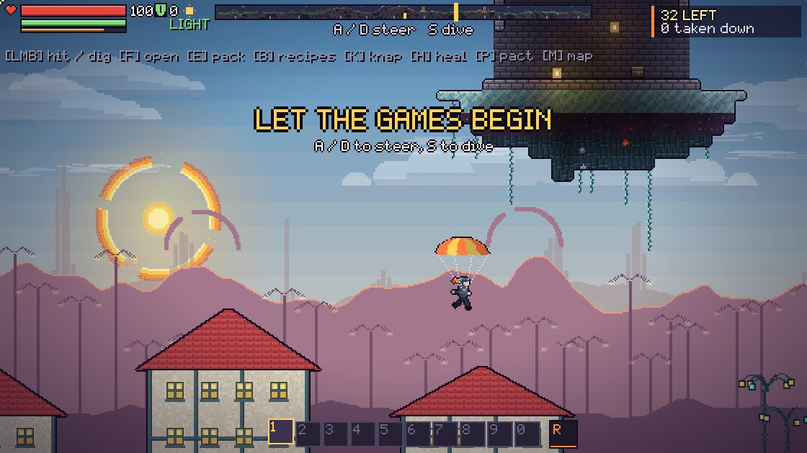
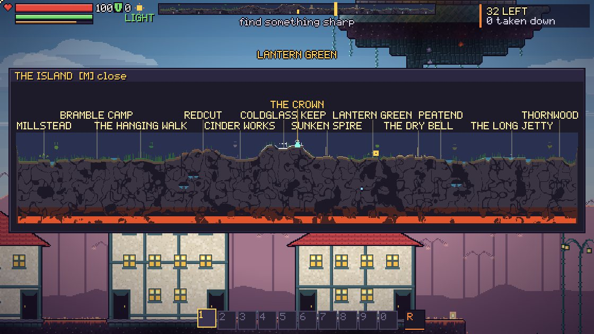

# The Ashfall: battle royale

On the title screen choose **THE ASHFALL : BATTLE ROYALE**.

## A match

Thirty-two of you fall out of the sky, each over a different stretch of an island 3,500 paces wide. Steer your canopy with **A / D** and hold **S** to dive. You land with **nothing**: no tools, no weapons, no salves. **Echoes** (computer players) fill the empty places, and they land with nothing too.

Gather, dig, make something sharp, find someone you trust, and outlast everyone else. The last Waker standing wins (or the last pact). When you fall you drop everything you carry, and can watch the others (**A / D** to switch). **Tab** shows who is left, **M** the island.

## Making what you fight with

Nobody finds a fine weapon in the first minute any more. You make yours, and the benches in your pack (**E**), the recipe book (**B**) and knapping (**K**) all work as they do in a world.

1. **By hand.** Gather sticks, pebbles, berries, grass and reeds as you walk (they turn into rock, flint, fibre and food), and hit trees for logs. Three fibre make twine, and so do three reeds or a hide; in the dunes, the ash and the Reach, look for dead bushes. A **Stone Club** (a stick, two rocks, twine) or a **Flint Spear** (a spear point, two sticks, twine) is enough to win with.
2. **At a workbench.** Most places on the map have one, or build your own by hand. Bone weapons, a bow, better tools.
3. **At a bloomery and an anvil.** They stand in a few places on the surface and in the **Hollow Forges** underground. Copper, then bronze and iron, all from ore you dug yourself.

Better metal helps without deciding the fight: only half of what a weapon has over flint counts here, and quick or far-reaching weapons hit a little softer. Bows need arrows, and you make those too.

**Chests** (**F**) are few. They hold two or three plain things, which drop at the chest's foot when it opens: sticks and fibre, a little ore, food, perhaps an **Ember Salve** or a **Ward Shard**. A weapon is rare, and it is never a great one. Chests with a gold lid, deep or hard to reach, are a little better.

Hold a salve or a ward and click to use it (or press **H**): it takes a moment, and a blow interrupts it. A ward takes blows before your health does.

## Digging, the caves, and how deep is too deep

You can dig anywhere: with your hands through soil (slowly), with a pick through rock. Under the island are winding caves, great halls and places with names: the **Hollow Forge**, the **Underlake**, the **Bone Cathedral**, the **Crystal Heart**, the **Glowcap Garden** and the **Ember Brink**. Sinkholes and cave mouths lead down to them, with vines to climb back up (**W** to climb, and **W** with **A** or **D** to leap off). The good ore is there, and so are things that live there.

Don't go too far. About **145 paces** down the rock itself begins to burn you, worse the further you go. At about **170 paces** is the molten sea, and nothing comes back out of it.

## The border

The **ashfall** closes in from both sides, but it doesn't watch the clock: it waits for people to fall. The line under the strip at the top says how many must be left before it stirs (with 32 in the match: 24, 16, 10, 6, 3 and 2). Then you get a warning of 40 seconds, and it moves slowly enough to walk ahead of. The strip shows the safe ground, and white lines show the next safe ground. Outside it you lose health, faster each time it closes. (If nobody at all falls for five minutes, it grows restless and stirs anyway.)

## Pacts

Stand close to another Waker, or to an echo, and press **P** to offer a pact. If one is offered to you, **P** accepts it. (An echo makes up its own mind: a hurt or cautious one is likelier to say yes, one you have just struck never will, and near the end a bold one may turn on you.) You can't hurt each other, you see each other on the map, and you can win together.

To **leave a pact**, press **P** twice, or press **Esc** and choose **LEAVE PACT**. From then on you are fair game to each other. A pact also ends when one of you falls.

## The games

- **Beasts** roam by day and hunt by night, different ones in every land, and they can kill you (and the echoes). Caves have their own, and some of the great rooms are nests.
- **The weather** changes during a match, the same for everyone: see *Weather* in *How to play*.
- **Sponsors.** Make your first weapon, take someone down, or come very close to dying, and a parcel may come down on a chute.
- **The Feast.** When half the field has fallen, four tables are laid at the Crown, in the middle of the island. Everyone is told.
- **The Marked One.** Whoever has taken down the most (three or more) is marked for all to see.
- **Wildfire and poison fog** take a stretch of the safe ground for a while. The strip warns you first.
- **The hounds** are let loose when only a few are left.
- **The fallen.** A cannon sounds for each, and now and then their faces show in the sky.

Every match earns pass experience and, in ranked matches, a rating. A higher pass earns a title and nothing else: everyone starts with empty hands.

## Three ways to play

- **PLAY WITH ECHOES:** you and thirty-one echoes, right away.
- **HOST A MATCH FOR FRIENDS:** a lobby with a game code, for up to eight of you. Friends pick **JOIN A FRIEND** and type it, then you press **START NOW**; echoes fill the rest. Works from the HTML file and the Mac app, on any internet connection (the relay carries it when needed, as in *Playing together*).
- **PLAY ONLINE** (only when the page is opened on claude.ai): everyone who has the page open and picks the same match name meets in one lobby. The first one in leads: the match starts after a short countdown, or when they press **START NOW**.

With friends or online, the land you dig, dropped things, chests and echoes are the same for everyone. The beasts, and where lightning strikes, are not: each computer runs its own.
