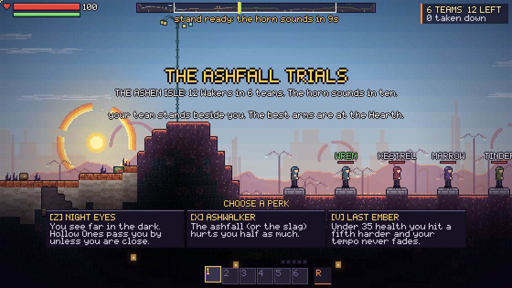
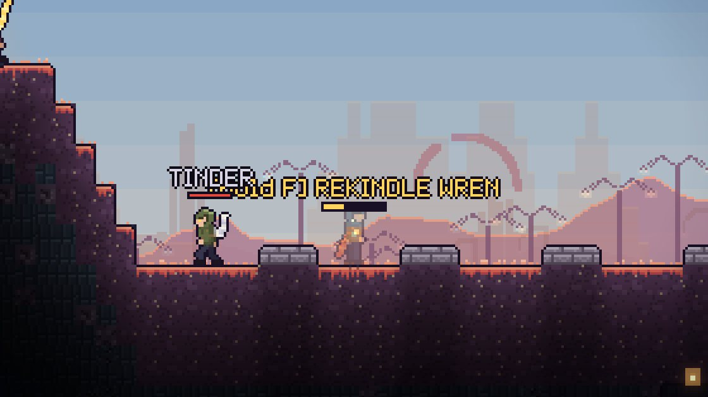
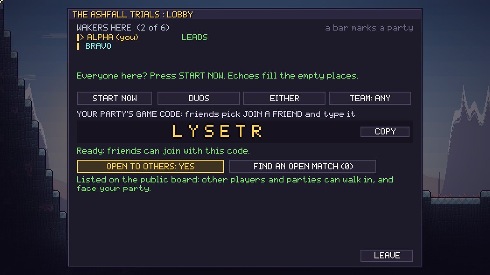

# The Ashfall Trials

On the home screen, under **THE ARENAS**, choose **THE ASHFALL TRIALS**. It is a survival match for twelve: you, your friends, other people's parties, and echoes (computer players) in every empty place. A match lasts up to about fourteen minutes. The Trials have their own kit: **perks** you choose, **amps** you fit to your weapons, **relic** weapons found nowhere else, and two **arenas**.

## A match, from the horn to the last ember

1. **The plinths.** Everyone starts on a plinth round the **Hearth**, in the middle of the island. Nobody can move for ten seconds, and in those seconds you **choose a perk** (see below). Then the **horn** sounds.
2. **Hearth or wilds.** The chests at the Hearth hold good weapons, and everyone can see everyone there. The wilds are safer and poorer. You start with bare fists.
3. **Scavenge.** Press **F** at chests for weapons (the glow under a dropped weapon shows how rare it is), **salves** and **draughts** (health), **ward shards** and **flasks** (a ward that takes blows before your health does), sidearms, arrows, **rations** and **scrap iron**. Pick **berries** from bushes (**F**).
4. **Hunger.** The bar under your health runs down. Well fed, you mend on your own; starving, you fade. Hold food and click to eat it, or press **H**.
5. **Camps.** Each camp has a fire and an **anvil**. With a weapon in hand and enough scrap, **F** at the anvil **reforges** it into the next better weapon of the same kind.
6. **Favor.** The crowd is watching. Blows struck in time, clean hits, clashes, crescendos, takedowns, finding new places, living through a night and rekindling a teammate all earn **favor**. When the bar fills, a **sponsor's gift** floats down to you: what you most need.
7. **Night.** There are three days and three nights. At nightfall the names of **the fallen** are read out (you hear a cannon each time someone falls), it gets dark, and **Hollow Ones** walk the island until dawn. They drop food and scrap.
8. **The barge.** Twice a match the Ember Barge sets down a **supply crate**. Everyone is told where, 25 seconds ahead; the strip at the top and the map (**M**) mark it.
9. **The feast.** The two **sealed chests** on top of the Hearth open about six minutes in, with the best weapons on the island. Everyone is told half a minute ahead.
10. **The ashfall.** It closes in from both sides and ends **on the Hearth**, so a match finishes where it began. Outside it you lose health, faster each time it closes.

## Perks

On the plinth you are offered **three perks: pick one** (press **Z**, **X** or **V**, or click it). At each **dawn** you are offered three more. They last the match and show under your hotbar.

| Perk | What it does |
|---|---|
| **Fleet** | You run a tenth faster. |
| **Iron Gut** | Hunger comes on half as fast, and every meal mends you. |
| **Night Eyes** | You see far in the dark. Hollow Ones pass you by unless you are close. |
| **Scavenger** | Chests give one thing more. Bushes give double. |
| **Tinker** | Reforging costs 1 scrap less. Your weapons take a third amp. |
| **Second Wind** | Once a match, a killing blow leaves you standing at 1 health. |
| **Crowd Favorite** | You win favor half again as fast. |
| **Ashwalker** | The ashfall (or the slag) hurts you half as much. |
| **Bloodrush** | A takedown gives back 30 health and all your stamina. |
| **Steady Hands** | The glint lasts longer for you. Rushing costs no tempo. |
| **Field Medic** | You rekindle teammates twice as fast. They rise with 70 health. |
| **Brawler** | Your bare fists hit far harder. |
| **Last Ember** | Under 35 health you hit a fifth harder and your tempo never fades. |
| **Quicksilver** | Dodging costs half the stamina. |

## Amps

An **amp** is a small charm you find in chests, crates and gifts. **Hold it and click** and it is fitted to the weapon you held last. A weapon takes **two** amps (three if you are a Tinker). The pips beside a weapon in your hotbar show what it carries, and a weapon keeps its amps when it is dropped: take one from a fallen rival and you take theirs.

| Amp | What it does |
|---|---|
| **Sear** | Blows struck in time set the foe alight. |
| **Rime** | Clean blows chill: the foe is slowed. |
| **Leech** | Crisp blows give back 3 health. |
| **Reach** | A sixth more reach. |
| **Weight** | Blows throw foes further and break guards faster. Swings are a little slower. |
| **Quicken** | Swings come a tenth faster. |
| **Echo** | Every third blow in time lands again a moment later. |
| **Thorn** | A clash hurts whoever you turned aside. |
| **Kindle** | Your embers of tempo do not fade. |
| **Venom** | Clean blows poison. |

Most amps only work for blows struck **in time** or **clean**: they reward the same play the rest of the game does.

## Relics

Six weapons exist only in the Trials, one for each kind, and only in the **feast**, the **barge's crates** and **sponsors' gifts**. Each is a little stronger than the best ordinary weapon of its kind and comes with **two amps already in it**: **Embertongue** (blade: Sear, Kindle), **Longwatch** (pike: Reach, Weight), **the Whispers** (fangs: Venom, Leech), **the Anvil's Answer** (maul: Weight, Thorn), **Widow's String** (bow: Echo, Quicken) and **Stormcoil** (chain: Quicken, Sear).

## Two arenas

- **THE ASHEN ISLE**: the island described above. The ashfall closes from both sides.
- **EMBER PEAK**: a mountain with the Hearth on its summit. There is no ashfall here: **slag rises** from below, so the fight climbs. There are no tunnels to hide in.

Choose one, or **EITHER** for a surprise (in a lobby the leader chooses).

When you fall you drop everything you carried and can watch the others (**A / D** to switch). **Tab** shows who is left.

Fights use the same rules as everywhere else: strike on the glint, never mash (see *How to play: Fighting*). Blows do less damage in the Trials than in the world, so a fight lasts long enough to be won by timing.

## Teams

Choose **SOLO**, **DUOS** or **TRIOS** before you start (in a lobby, the leader chooses; press **TEAM** to ask for a team number, so friends can share one or face each other). Teammates stand on neighbouring plinths, show in green, cannot hurt each other, and are listed on the left with their health.

A fallen teammate leaves an **ember** for 45 seconds. Stand on it and **hold F** for about three seconds to **rekindle** them: they get up with 40 health and bare fists. A team is out when nobody on it is standing. The last team standing wins together.

## Parties: with your friends, against other people

A **party** is you and your friends, kept together on **one team**, in a match that has other people in it too.

1. Choose **MAKE A PARTY (HOST A LOBBY)**. You get a game code. Your friends pick **JOIN A FRIEND** on the home screen and type it. Everyone who joins this way is in your party, and the lobby shows each party as a coloured bar.
2. Then either:
   - press **FIND AN OPEN MATCH** and pick one from the list: **your whole party goes with you** into that lobby, and lands on one team; or
   - set **OPEN TO OTHERS: YES** so that other people (and their parties) can find your lobby and come to you, and press **START NOW** when you have enough.

Set the team size to fit your party (**DUOS** for two, **TRIOS** for three). A party bigger than a team is split across teams that start side by side. Up to **six people** can share a lobby; echoes fill the rest of the twelve places.

**OPEN MATCHES** on the Trials screen shows every lobby that is open right now, without making a party first: pick one and you join it alone.

On claude.ai, where everyone with the page open shares a lobby by name, type the same **PARTY** word as your friends and you are put on one team.

## Your record

When a match ends you get a **title** for how you played it: **the Reaper** (five takedowns), **the Answer** (blows turned aside), **the Metronome** (crisp blows), **the Keeper of Embers** (teammates rekindled), **the Magpie** (chests), **the Edge** (clean blows), **the Ghost** (a win without a takedown), and more. Your **career** (matches, wins, takedowns, best place) is kept on this computer and shown on the Trials screen.

## Other ways to play

- **PLAY WITH ECHOES:** you and eleven echoes, right away. In duos or trios the rest of your team are echoes: they stay near you, fight beside you and rekindle you.
- **PLAY ONLINE** (only when the page is opened on claude.ai): everyone who has the page open and picks the same match name meets in one lobby. The first one in leads: the match starts after a short countdown, or when they press **START NOW**.

Parties and open matches work from the HTML file and the Mac app, on any internet connection (the relay carries it when needed, as in *Playing together*).

# The Cinder Ring

Also under **THE ARENAS**: a small arena with every weapon, for quick duels to ten takedowns. **HOST A RING FOR FRIENDS (GAME CODE)** gives you a code for up to three friends (they pick **JOIN A FRIEND**); on claude.ai there is an open ring as well; and you can always practise against echoes.
