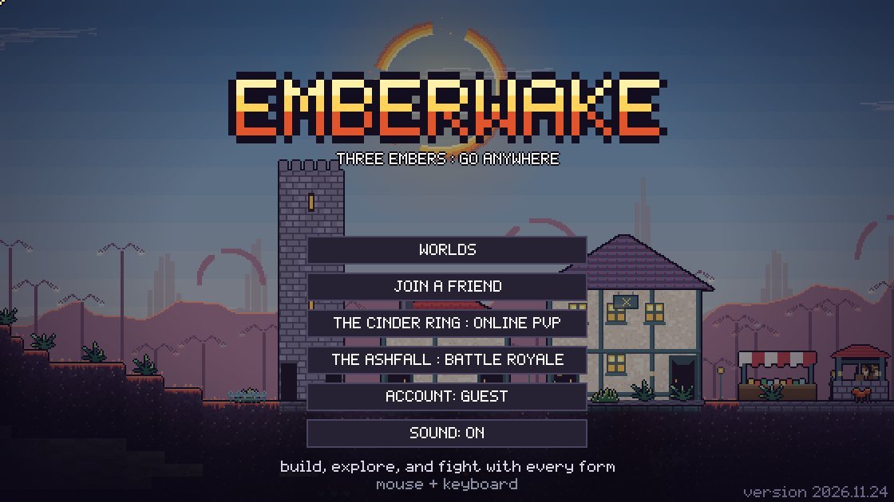

# Emberwake

**Emberwake** is a 2D pixel-art open-world action game inspired by *Terraria*. Gather resources, build a settlement, learn to fight by the beat, explore an endless world and seven other worlds beneath and above it, and face powerful guardians, alone or with up to three friends.

Made with freemessycello and fish.co — a self-contained HTML game with no external runtime dependencies.



## Play

Ready-to-play builds are in [`Emberwake-1/`](Emberwake-1/).

Play the game in your browser at <https://rogersg61.github.io/Emberwake/>.

### macOS

Open [`Emberwake.app`](Emberwake-1/Emberwake.app). To keep it permanently, drag it into the Applications folder.

macOS may block the app because it is not notarized by Apple:

- **macOS 15 Sequoia and later:** open the app once, choose **Done**, then open **System Settings > Privacy & Security** and choose **Open Anyway**.
- **Earlier macOS:** right-click or Control-click the app, choose **Open**, then choose **Open** again.

### Windows, Linux, ChromeOS, or any modern browser

Open [`Emberwake.html`](Emberwake-1/Emberwake.html) directly in Chrome, Edge, Firefox, or Safari. It works without a server or internet connection for single-player play, and on a phone or tablet touch controls appear by themselves.

You can also open the included [`Emberwake Guide.html`](Emberwake-1/Emberwake%20Guide.html) for the complete in-game manual.

## Features

This version joins two that had grown apart: the uploaded "Emberwake 2" (the home screen, the look, fighting by the beat, the Ashfall Trials, the worlds past the floors) and this repository's own work (accounts, touch controls, weather that is felt, fire, brews, two new lands).

- Endless exploration in the Waking Lands, where every world has three traits from its seed, lands with moods, a year of four seasons, and curios on the road
- Seven other worlds: three beneath and above (Cinderdeep, the Rootdark, the Glass Expanse) and four past the floors (the Long Winter, the Stopped Hour, the Stormhead, the Outside), each with its own forge, steel and guardian
- Two new lands in worlds made from now on, the Mosswood and the Willowmere, with moss deer, willow hens, oaks and willows; older worlds keep their land exactly as it was
- Mining, digging, building, furniture, storage, planters and beehives, and crafting at benches that each have one job
- Fighting by the beat: strike again when your weapon glints, build tempo, spend it on a heavy blow, break guards, clash and answer; seven weapon families with learned styles, counters, arts, armour, and trinkets
- Carried momentum: hold a direction through a blow or a dodge and you keep most of your run
- Weather that is felt (rain, snow, thunderstorms, fog, ashfall), shelter from it, and six rare creatures that only the weather brings out
- Fire that burns where a flask breaks, that rain puts out and lightning can start
- Eating that takes a moment, hot meals with boons, and brews: Quickstep, Emberheart, and the Doublesoul Draught that calls a mirror of you
- Story leads, lore, echo stones, a journal, creatures, guardians woken by offerings, and world events
- Shared multiplayer worlds for up to four players
- The Ashfall Trials, a survival match for twelve with echoes or friends, with teams, perks, amps, relics, two arenas and parties; and the Cinder Ring for quick duels
- The Wilds, a third arena for 32: fall with nothing, gather, dig, craft, make pacts; souls and coins for the soul wheel and the shop
- Echoes (computer players) that find real routes over walls and gaps, choose their fights, and keep the beat as well as their skill allows
- Accounts kept in the browser: a name and a password, a look and a hat, and each account's own worlds
- An optional online social board: username friend requests, private chat, friend-only activity, and Ember-coin gifts (requires running the included service)
- Touch controls for phones and tablets
- Synthesized pixel graphics and sound with no image or audio downloads

## Controls

| Input | Action |
| --- | --- |
| `A` / `D` | Move |
| `Space` or `W` | Jump (hold `S` to drop through bridges) |
| `Shift` | Dodge (dodge through a hit at the last moment, then strike back: a riposte) |
| `Left mouse` | A light blow. Strike again when your weapon glints, not before. Holding it down does not attack |
| `Right mouse` or `Q` | A heavy blow: spends your tempo for a harder hit (hold to charge); also opens doors |
| `V` | Change weapon style |
| `X` | Swap to your off-hand weapon |
| `1`–`0` / mouse wheel | Select hotbar item |
| `E` | Pack, what you wear, and crafting by hand |
| `B` | Recipe book |
| `G` | Drop one of what you hold (`Shift+G` drops the whole stack) |
| `F` | Talk, use a bench, sleep, plant, wake a guardian with its offering |
| `H` | Quick heal |
| `J` | Journal: leads, lore, echoes, bestiary |
| `M` | Map (once you have drawn one; in the Trials, the island) |
| `K` | Knapping |
| `C` | Forms (your moves) |
| `R` / `T` | Throw / switch sidearm |
| `O` | Sound on or off |
| `P` or `Esc` | Menu (**PLAY TOGETHER** is in here). In the Wilds `P` offers, accepts and leaves a pact, and only `Esc` opens the menu |
| `Enter` | Chat while playing together |

### Touch

On a phone or tablet, held either way up, the game shows a stick to move and the buttons **JUMP**, **USE**, **LIGHT** and **HEAVY**, with **PACK**, **MAP**, **HEAL**, **MENU** and **CLOSE** beside them, and **CHAT** when friends are in your world. A finger on the world digs, gathers or strikes exactly there, a slide scrolls lists, and tapping a field brings up the keyboard. The beat is the same as with a mouse: tap again on the glint.

### Accounts

The game opens on a sign-in board. Create an account (a name and a password of at least eight characters) and choose a look and a hat. Accounts and their worlds stay in the browser or app they were made in; worlds from before accounts go to the first account created. The account name and **SIGN OUT** sit above the worlds board, and **CHANGE LOOK** is on the accounts board.

See [`Emberwake Guide.html`](Emberwake-1/Emberwake%20Guide.html) or [`Source/guide/`](Emberwake-1/Source/guide/) for the full controls and gameplay guide.

## Playing together

1. Open a world and press `Esc`.
2. Choose **PLAY TOGETHER**.
3. Share the generated six-character game code with a friend.
4. Your friend chooses **JOIN A FRIEND**, enters their name and the code, and joins.

Emberwake uses direct peer-to-peer connections when possible and falls back to a relay when restrictive networks block them. Multiplayer does not require port forwarding.

To move a save between the Mac app and a browser or another computer, open the world list and use **COPY**, then sign in on the destination and use **PASTE A WORLD**.

> Every player must use the same Emberwake version. On different computers, share the latest `Emberwake.html` or `Emberwake.app` build.

## Social board

The optional **SOCIAL** button on the home screen opens username accounts, friend requests, private chat, friend activity and coin gifts. It uses a separate online account and wallet; the existing local accounts and arena balances are unchanged. To try it locally, follow the [social service instructions](Emberwake-1/Source/README.md#social-board). For cross-device use, the service and game must be deployed together behind HTTPS.

## Building from source

The source has no package or dependency installation step. It requires Python 3; Node.js is optional and enables JavaScript syntax checking during the build.

```bash
cd Emberwake-1/Source

# Build the game, guide, and macOS app
python3 build.py

# Build only Emberwake.html
python3 build.py --game

# Build the HTML game and guide without rebuilding the app
python3 build.py --no-app
```

The build output is written to `Emberwake-1/`:

- `Emberwake.html` — cross-platform browser game
- `Emberwake Guide.html` — generated HTML guide
- `Emberwake.app` — macOS application bundle

The builder concatenates numbered JavaScript source files, checks for duplicate top-level names, validates syntax with Node.js when available, embeds guide images, and packages the Mac app.

## Source layout

| Path | Purpose |
| --- | --- |
| [`Emberwake-1/Source/game/`](Emberwake-1/Source/game/) | Numbered JavaScript game modules |
| [`Emberwake-1/Source/guide/`](Emberwake-1/Source/guide/) | Guide chapters and embedded images |
| [`Emberwake-1/Source/mac/`](Emberwake-1/Source/mac/) | macOS launcher, window shell, and app metadata |
| [`Emberwake-1/Source/tests/`](Emberwake-1/Source/tests/) | Automated Playwright browser tests |
| [`Emberwake-1/Source/build.py`](Emberwake-1/Source/build.py) | Game, guide, and app builder |

The JavaScript modules share one global scope. Files load in numeric folder and filename order, and the builder prevents accidental duplicate names.

## Testing

The browser tests require Python, Playwright, and Chromium:

```bash
cd Emberwake-1/Source
pip install playwright pillow
python3 -m playwright install chromium

python3 build.py --game                # the tests play the built game

python3 tests/run.py                   # everything
python3 tests/run.py together          # one group
python3 tests/run.py together/relay.py # one test
```

The tests open the built game in a hidden Chromium, play it from code, and print what they see. The multiplayer tests use a small local message board, so nothing reaches the internet.

See [`Emberwake-1/Source/tests/README.md`](Emberwake-1/Source/tests/README.md) for test groups and setup details.

## Saving

Saves are stored locally on the computer and browser profile used to play, under the account that made them. The app and browser are separate storage environments, each with its own accounts. World lists include copy/paste controls for transferring saves.
